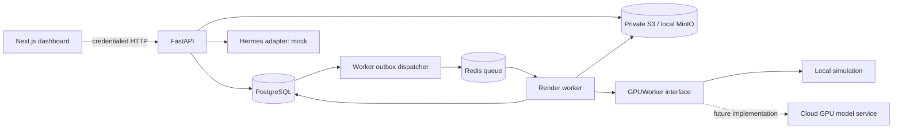

# Concrete architecture

## Flow

The browser never receives database, S3 or provider credentials. FastAPI authorizes every entity read and every relationship. Downloads pass through the API to keep MinIO private. API and worker share one Python package and image, so validation and adapter contracts remain consistent.

## Data model and tenant boundaries

`tenants` owns `users`. Each user belongs to exactly one tenant in Phase 1. `sessions` supports expiry and server-side logout revocation. `records` stores project, scene, asset, consent, character, voice, job, agent_task and audit entities as validated JSON documents, indexed by tenant and kind. A tenant/kind/request-key unique constraint prevents duplicate render submissions.

This intentionally small schema makes the initial foundation easy to extend. Relationships inside JSON are validated in application code rather than foreign keys. Before team collaboration or billing, split high-volume entities into dedicated relational tables, add composite tenant foreign keys, versioned Alembic migrations and PostgreSQL row-level policies. Phase 1 tenant isolation is enforced by the API and worker, not PostgreSQL RLS. Raw database access is privileged and bypasses that boundary.

The initial `python -m gsn.migrate` command creates missing tables. It will not alter existing columns. Do not use `create_all` to migrate future schema changes; add reviewed versioned migrations first. Back up existing data before schema changes.

## Authentication

Passwords use Argon2. Signed JWT session cookies are HttpOnly, SameSite Strict, expire after eight hours and refer to a stored, revocable session. Tenant IDs come from the authenticated user, never submitted request data. Browser mutations reject unexpected Origin headers. `COOKIE_SECURE=false` is only for local HTTP; a public deployment needs HTTPS, secure cookies and a same-site API domain. Use `localhost` consistently rather than mixing it with `127.0.0.1`.

No password reset, verified email, MFA, team roles, invitation flow or rate limiting is implemented. Registration creates a fresh isolated tenant. Add identity-provider support and shared Redis-backed login throttling before public access. Audit records are read-only through the API, but are not tamper-proof against database administrators. Backups, immutable retention and external audit export are later deployment work.

## Consent and reference files

Consent records include subject, scope, evidence asset, expiry, commercial authorization, attestation, recorder and revocation timestamp. Character and voice profiles require matching active consent and matching reference media types. Scene creation, render submission and execution recheck permissions. Revocation does not delete assets or retract finished work. A future long-running cloud service must support cancellation and a final consent gate before publishing; the current worker only performs a short mock render.

Uploads are limited to 20 MB and an allowed declared media type. Files are private, use generated tenant-prefixed keys and are downloaded as attachments. File signature inspection, virus scanning, storage quotas, retention/deletion and independent subject verification remain launch requirements. Do not ingest untrusted customer uploads until those controls exist.

## Job lifecycle

`queued → running → succeeded | failed`. The render API commits a job and audit entry together. The job itself is the durable outbox. The worker scans it, sends bounded Redis notifications and claims work with PostgreSQL row locks. Notification loss is recovered by rescanning. Duplicate deliveries see the completed job and exit. A five-minute lease allows crash recovery; at most three claims are allowed. Ordinary validation/provider errors end in failed; submit a new request key after fixing the error. There is no cancel/retry UI yet.

Output object keys are deterministic per job; successful mock jobs reference a downloadable JSON artifact and report zero provider cost. Other costs are unknown (`null`), not advertised as free. JSON objects are assigned afresh when changing state so SQLAlchemy persists changes. Redis uses AOF in Compose, but PostgreSQL is the source of truth.

The dispatcher currently scans all jobs. Add indexed typed job state, pagination and a separate dispatcher at scale. SQLite tests do not establish PostgreSQL locking guarantees; CI separately runs against PostgreSQL and starts the Compose integration stack.

## Hybrid local / cloud contract

Keep web, API, PostgreSQL and Redis local while developing. Initially run the worker locally with `RENDER_MODE=mock`. Production can move those services to managed infrastructure and deploy the same worker package on a controlled cloud network.

Do not expose local PostgreSQL/Redis to the internet for a cloud worker. Use a private VPN/network or implement a narrowly scoped authenticated job-lease API. Cloud workers need scoped job payloads, short-lived storage access, model/workflow version, seed, reference hashes, tenant ownership, duration/resolution limits, provider request ID, timeout, cost ceiling and cancellation. Return an artifact manifest with MIME, checksum and provider metadata. Add lease heartbeats for jobs lasting more than five minutes.

`GPUWorker.render(scene) -> (bytes, content_type)` is the Phase 1 local interface. `CloudGPUWorker` currently raises an explicit error. A real implementation must return a typed artifact manifest and use output filenames based on the real media type rather than the simulation filename. `HERMES_MODE` and `RENDER_MODE` default to mock; any other mode fails closed. Setting an environment variable alone does not activate a live integration.

Before adding a GPU provider: implement a sandbox test, validate its model license and intended uses, enforce a hard spend cap, generate one authorized short clip, inspect output and cost, test failure/cancellation, and record evidence. No provider, workflow or model is selected or represented as tested in this repository.
